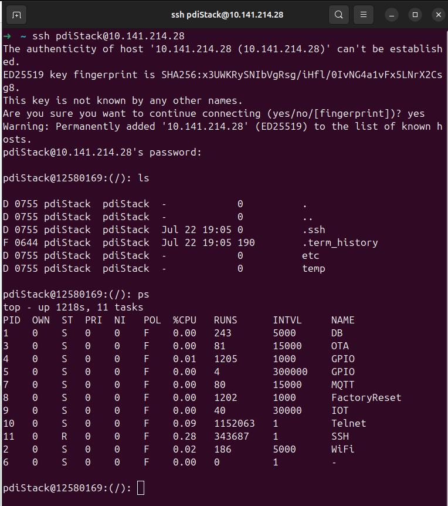
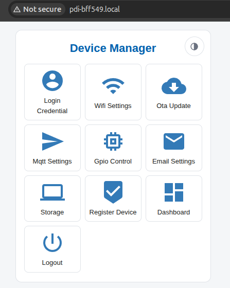
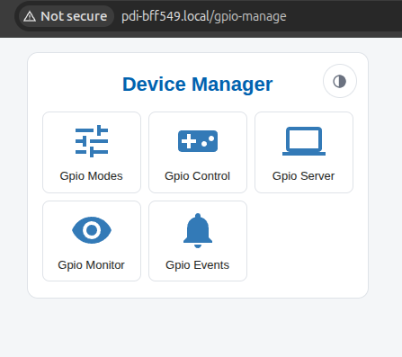
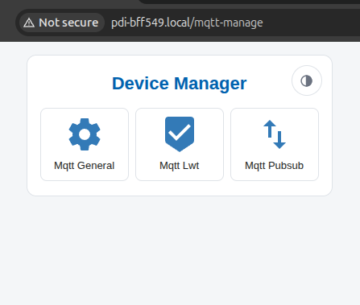
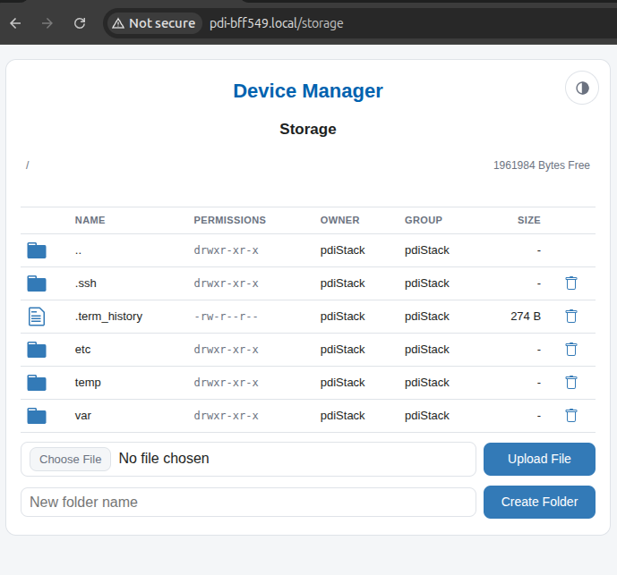
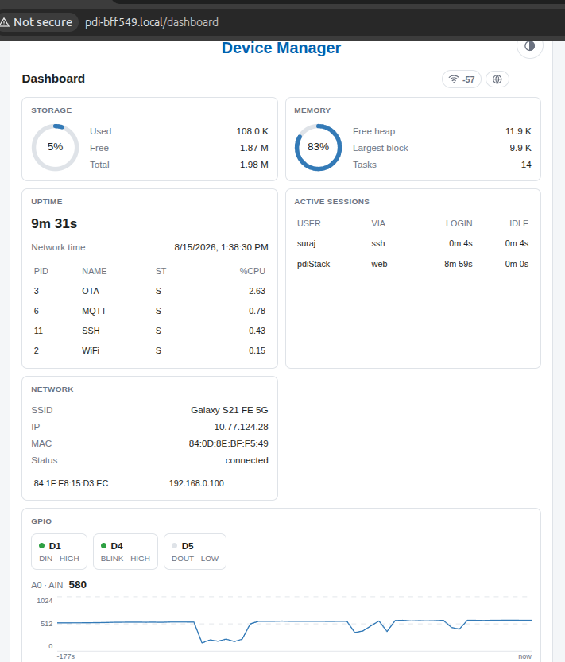

# PDI Framework — Portable Device Interface Stack

**Portable Device Interface (PDI) is a C++ framework that boots your device into a tiny OS.**

PDI is a set of libraries tied together — WiFi, storage, networking, scheduling, security, logging — and on top of them runs a tiny operating system your board starts into. Flash one sketch and the device comes up with a web portal, an SSH server, MQTT, over-the-air updates, a filesystem with real users and file permissions, and a Linux-style shell you can log into over serial, Telnet or SSH.

**Every device inherits what its own hardware can give.** The operating system is written once, against capabilities rather than chips. A board with a radio gets the networking services; one without simply has them left out of its build, and not a line above them changes. The same goes for storage, for TLS, for a second execution lane — each arrives because a port said it could carry it. Adding a new board means describing what that board can do, not porting the system to it.

**Small on the device, big in what it gives you.** It fits in the flash of an ordinary microcontroller and still hands you the things you would otherwise build yourself every time: remote login, file transfer, scheduled jobs, firmware updates over WiFi, a configuration UI, and an API to your own hardware. You write normal Arduino code on top, and the same sketch moves from one board to another.

**Stability comes from staying inside the board's limits.** Enable the services the hardware can carry — flash and RAM are the budget — and the device keeps running without resets or dropped connections. That is what the test suite checks: 2000+ unit tests, and 700+ feature tests driven on real hardware — two different boards at once, each over serial, Telnet and SSH at the same time.

## Quick Start

1. **Install the board package** from the Arduino Boards Manager, at exactly the version in [Supported Boards](#supported-boards). Boards Manager offers the newest by default; a newer core can need changes in the board's adapter.
2. **Install the library** from the Arduino Library Manager: search **pdi-framework**.
3. **Pick the board's settings.**
   - **ESP32:** Tools → Partition Scheme → **Minimal SPIFFS (1.9MB APP with OTA)**. The image is about 1.9 MB, and the default scheme's 1.3 MB app slot cannot hold it ("Sketch too big"). It fills about 94% of that slot, so a large application of your own makes room by switching off services it does not need ([what costs the most](doc/memory-performance.md#123-the-expensive-features)).
   - **ESP8266 or Arduino Mega 2560:** generate the device files once, from a terminal in the installed library's `scripts` folder:
     ```
     cd ~/Arduino/libraries/pdi-framework/scripts        # Windows: %USERPROFILE%\Documents\Arduino\libraries\pdi-framework\scripts
     python3 DeviceSetup.py -d esp8266          # or: -d arduinomega
     ```
     Run it again with `-d esp32` to go back. The board's default Tools settings work.
4. **Open File → Examples → pdi-framework → PdiStack**, select the board and port, and upload. That sketch is the whole application:

   ```cpp
   #include <PdiStack.h>

   void setup() {
    PdiStack.initialize();
   }

   void loop() {
    PdiStack.serve();
   }
   ```

   `initialize()` mounts the filesystem tree and starts every service the build enables. `serve()` is the loop body that keeps them all running. Your own code goes alongside these two calls, not instead of them.
5. **Log in over the cable.** Open the serial monitor at **115200**. The board prints one line per service as it starts, then `login:`. Log in as **`pdiStack`** with password **`pdiStack@123`**, and change that password straight away with `passwd` — the same default opens the access point and the portal. A board without a filesystem keeps no user accounts, so the Mega 2560 goes straight to the prompt.
6. **Put it on your WiFi** (boards with a radio). At the shell:
   ```
   net connsta,<your-ssid>,<your-password>
   net ip
   ```
   `net ip` shows the address your router gave it, and the boot log names it on the network as **`pdi-<xxxxxx>.local`**. Until the board has joined a network it keeps its own access point up and keeps retrying; once it has joined, losing the network for five minutes restarts it to recover.
7. **Reach it from your computer.**
   ```
   ssh pdiStack@pdi-<xxxxxx>.local          # or: telnet pdi-<xxxxxx>.local
   scp -s notes.txt pdiStack@pdi-<xxxxxx>.local:/notes.txt
   ```
   The **web portal** is at `http://<board-address>`, or join the board's own access point **`pdiStack`** (password `pdiStack@123`) and open **http://192.168.0.1**. On a device built with HTTPS, the portal moves to **HTTPS** once the device has made its certificate, which it does after joining your network: `http://` then forwards to `https://`, and the browser asks you to accept the board's self-signed certificate the first time.

Clone-based installs, PlatformIO, and what the setup script does are in [Build & Toolchain](doc/build.md).

### Supported Boards

| Device | Board package version | Status |
|---|---|---|
| esp32 | 3.3.3 | the full stack, portal over HTTPS |
| esp8266 | 3.1.2 | the full stack, portal over HTTP |
| arduinomega (Mega 2560) | 1.8.6 | the shell over serial, GPIO, time and settings; no network, no filesystem; not yet run on hardware |

**Default bus pins.** The GPIO numbers each board runs a driver's bus on when `/etc/devices.conf` names no pins for it ([devices](doc/services.md#624-serialserviceprovider--__serial_service)). They stay ordinary GPIOs until a line in that file uses the bus.

| Board | I2S — SCK, WS, SD | I2C — SDA, SCL | SPI — SCK, MISO, MOSI |
|---|---|---|---|
| esp32 (esp32dev and other classic boards) | 26, 27, 39 | 21, 22 | 18, 19, 23 |
| esp32-c3 | 3, 4, 5 | 8, 9 | 6, 1, 7 |
| esp32-s2 | 5, 6, 7 | 8, 9 | 36, 37, 35 |
| esp32-s3 | 17, 18, 21 | 8, 9 | 12, 13, 11 |
| esp32-c6 | 22, 23, 14 | 6, 7 | 21, 20, 19 |
| esp32-h2 | 5, 6, 7 | 12, 13 | 10, 11, 4 |
| esp8266 | — | 4, 5 | 14, 12, 13 (fixed) |

They are `I2S_GPIO_PINS`, `I2C_GPIO_PINS` and `SPI_GPIO_PINS` in `devices/<port>/DeviceControlInterface.h`, beside the pins the board keeps for its flash and console. An SPI device's chip select is not among them: every SPI line names its own with `cs=`.

## Your First Ten Minutes

Logged in over serial, this is a short tour of what is on the device. The output shown is from one of the test devices.

**What is this, and what is running?**
```
pdiStack@6832150:(/): uname -a
PDIStack pdi-15d3ec x.y.z-uEOS 1.1 ESP32-D0WD-V3
pdiStack@6832150:(/): service list
SERVICE        STATE     ENABLED  TASKS R/S/Z
Time           active    yes      1     1/0/0
WiFi           active    yes      1     1/0/0
HTTPServer     active    yes      0     0/0/0
SSH            active    yes      1     1/0/0
...
```
`help` lists every command with its usage line; [the command inventory](doc/shell.md#78-built-in-command-inventory) explains each one, and a short table under it shows the few whose arguments read differently from linux.

**Where is it on the network?**
```
pdiStack@6832150:(/): net ip
station :
         ssid      - MyWifi
         ip        - 192.168.1.42
access point :
         ssid      - pdiStack
         ip        - 192.168.0.1
```

**Look around the filesystem.** It is one tree, with live system state under `/proc` and `/sys`:
```
pdiStack@6832150:(/): ls /
pdiStack@6832150:(/): df
pdiStack@6832150:(/): cat /proc/meminfo
MemFree:      191564 B
MemMaxBlock:  110580 B
pdiStack@6832150:(/): ps | grep SSH
```

**Drive a pin.** Pins are files. Give a pin a mode first, then a value — mode `1` is digital write, `3` blinks at the value's interval in ms:
```
echo 1 > /sys/class/gpio/4/mode
echo 1 > /sys/class/gpio/4/value
echo 3 > /sys/class/gpio/4/mode
echo 500 > /sys/class/gpio/4/value
```
The number is the framework's pin, not the chip's GPIO number; on a NodeMCU pin 4 is D4, the on-board LED. [The pin table](doc/services.md#6212-storage-interface-init-no-provider) lists which GPIO each number drives.

**Keep a note, edit it, copy it off.**
```
echo first line > /notes.txt
fedit /notes.txt                 # Esc, then !w to save
```
and from your computer: `scp -s pdiStack@pdi-<xxxxxx>.local:/notes.txt .` Files of any size move the same way, to the flash or a mounted SD card, while the shell and the portal keep answering; the speed follows the board ([§7.10](doc/shell.md#710-sftp-and-scp-file-transfer)).

**Run something on a schedule.** Add a line to `/etc/crontab` and cron runs it every minute once the board has the time from the internet:
```
echo '* * * * * echo tick >> /tmp/ticks' >> /etc/crontab
```

**Add a user.** As `pdiStack`, which is root:
```
useradd u=alice p=<her-password>
su alice
```

Then open the portal in a browser for the same things with switches and forms, and look at the [examples](doc/examples.md) to add your own command, page, settings table or service.

## What You Can Do With It

**Log in to your board like a computer.** Open a serial monitor, or `ssh` in, or `telnet` in — you get the same login prompt and the same 75+ commands either way. `ls`, `cat`, `grep`, `ps`, `top`, `kill`, `df`, `chmod`, `ping`, `wget` and the rest all behave the way you expect, with tab completion, command history, an in-place file editor and Ctrl+C. Commands pipe into each other and redirect to files, so `ps | grep ssh` and `cat /proc/meminfo > /tmp/mem.txt` do exactly what they look like.

**Run it from a browser.** The device serves its own web portal: a live dashboard, a settings page for each service, GPIO switches, a file browser, MQTT and email testers, and firmware upload. Users sign in with their own accounts and see only what their permissions allow — the same rules the shell uses. It works on a phone and follows your light or dark theme.

**A real filesystem, with real users.** Files live on flash and survive reboots. `/proc` shows live memory, running tasks and network state. `/sys` exposes GPIO pins and network interfaces as files. `/tmp` lives in RAM. Every file has an owner and permission bits, so two people logged in at once genuinely see different things — `/etc/shadow` is readable by root and nobody else, and it means it.

**Control your hardware from anywhere.** Pins are files, so `echo 1 > /sys/class/gpio/5/mode` and then `echo 1 > /sys/class/gpio/5/value` turns one on from any terminal. The portal gives you switches for them. MQTT and HTTP reach them from across the internet, and a pin crossing a threshold can fire off an email or call a web endpoint on its own.

**Get it on the network, and find it again.** A captive portal appears on first boot so you can pick your WiFi from a phone with no code. After that the device announces itself as `pdi-<id>.local`, so you reach it by name instead of hunting for an IP address — it shows up in your router, in `avahi-browse`, and in Finder.

**Update it without plugging it in.** Push new firmware over WiFi from the portal, or from a file already on the device. No cable, no reflash, no losing your settings.

**Give it jobs to do.** Schedule a function to run every few seconds, once after a delay, or continuously on its own stack. Write shell scripts with `if`, `while`, `for` and variables and run them with `source`. Put ordinary cron lines in `/etc/crontab` for anything that should happen at a particular time. `/etc/rc.local` runs at boot, so a device can bring itself back up exactly as you left it.

**Settings you can read, not reflash.** WiFi, MQTT, OTA and email keep their configuration in plain text files under `/etc` that you can open, edit, copy off over SFTP and compare between two devices. Change a setting and restart the service — no rebuild.

**Secrets stay secret.** Stored passwords and keys are encrypted on the device, so a copy of its storage taken off it reveals nothing. SSH uses real host keys, HTTPS is available where the board can support it, and every log line can be shipped to a remote collector as well as kept on disk.

**Try the whole thing on your laptop.** The same code builds as a normal program on your computer — you can `ssh` into it, copy files to it and open its portal in a browser, all without a board plugged in. That is how the test suite checks every change before hardware is involved.

**Make it yours.** Add your own shell command, your own web page, your own settings table, or your own service, and the framework treats it exactly like the built-in ones. The bundled examples show each of these in a sketch you can copy.

## What's Inside

**19 services** — Time · Cron · WiFi · Web server · MQTT · OTA · SSH · Telnet · Email · GPIO · Serial · Shell · Database · User store · Login · mDNS · Syslog · Factory reset · Device-IoT.

You manage them the way you would on Linux: `service list` shows what is running, and `service start`, `stop`, `restart`, `enable` and `disable` do what they say. Stopping the SSH service really gives up port 22 rather than parking it — and the system will not let you stop the service carrying the session you are typing into.
Per-service reference in [§6 Service Providers](doc/services.md#6-service-providers).

**Things the services are built on**, rather than services themselves — TLS/HTTPS · SFTP and scp · link-layer mesh.

**75+ shell commands** — the full list is in [§7.8 Built-in command inventory](doc/shell.md#78-built-in-command-inventory).

**Storage** — one filesystem tree covering flash, `/proc`, `/sys`, `/dev` and `/tmp`, with Unix-style permissions and multi-user access control. An SD card is partitioned, formatted FAT or littlefs, and mounted with the linux commands for it — `sfdisk`, `mkfs`, `wipefs`, `mount` — and `/etc/fstab` mounts it whenever it is put in.
Details in [§6.2.12](doc/services.md#6212-storage-interface-init-no-provider).

**Building blocks** — task scheduler, event bus, queues, string and conversion helpers, crypto, and a compact C++ standard library for boards that ship without one.
Full inventory in [§15 Utility Library](doc/utility.md#15-utility-library).

**Extras** — captive portal, GPIO events over MQTT/HTTP/email, and NAT plus peer-to-peer mesh networking where the radio supports them ([§2.4.1](doc/build.md#241-nat-and-mesh)).

## A Peek at the Terminal and Web UI

<table>
  <tr>
    <td width="50%"></td>
    <td width="50%"></td>
  </tr>
  <tr>
    <td width="50%"></td>
    <td width="50%"></td>
  </tr>
  <tr>
    <td width="50%"></td>
    <td width="50%"></td>
  </tr>
  <tr>
    <td width="50%"></td>
    <td width="50%"></td>
  </tr>
  <tr>
    <td width="50%"></td>
    <td width="50%"></td>
  </tr>
  <tr>
    <td width="50%"></td>
    <td width="50%"></td>
  </tr>
  <tr>
    <td ></td>
  </tr>
</table>

## Documentation

The reference is in [doc/](doc/), one page per part of the framework:

| Page | What it covers |
|---|---|
| [Architecture](doc/architecture.md) | the layered model, ports and adapters, how a boot runs |
| [Build & Toolchain](doc/build.md) | installing, switching boards, PlatformIO, the setup scripts, vendored code |
| [Configuration](doc/configuration.md) | every `ENABLE_*` flag, what depends on it, `/etc` config files |
| [Task Scheduler](doc/scheduler.md) | the three task modes, the policies, and how to choose |
| [Database](doc/database.md) | the record store, storage and eeprom tiers, adding a table |
| [Services](doc/services.md) | each service: how it starts, its shell and web surface, its events; devices and storage |
| [Shell](doc/shell.md) | every command, pipes, variables, scripts, cron, SSH and SFTP, adding a command |
| [Web Server](doc/web-server.md) | requests, routes, pages, HTTPS, adding a page |
| [Logger](doc/logger.md) | levels, console and syslog, what ships switched off |
| [Transports](doc/transports.md) | the HTTP, MQTT and SMTP clients |
| [Examples](doc/examples.md) | what each bundled sketch shows, and in which order to read them |
| [Memory & Performance](doc/memory-performance.md) | flash and RAM per feature, what to switch off |
| [Portable Interfaces](doc/interfaces.md) | the interfaces every board adapter implements |
| [Porting](doc/porting.md) | adding a new board |
| [Utility Library](doc/utility.md) | event bus, strings, the embedded STL, crypto |
| [Extending](doc/extending.md) | adding services, commands, pages and tables |
| [Testing](doc/testing.md) | the test tiers, running them, adding a test |
| [Troubleshooting & FAQ](doc/troubleshooting.md) | common problems and their fixes |

## License

GPL-3.0 — see [LICENSE](LICENSE). Issues and questions: <https://github.com/Suraj151/pdi-framework/issues>.
