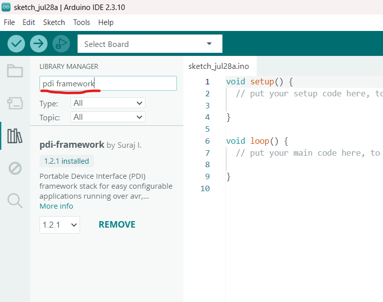
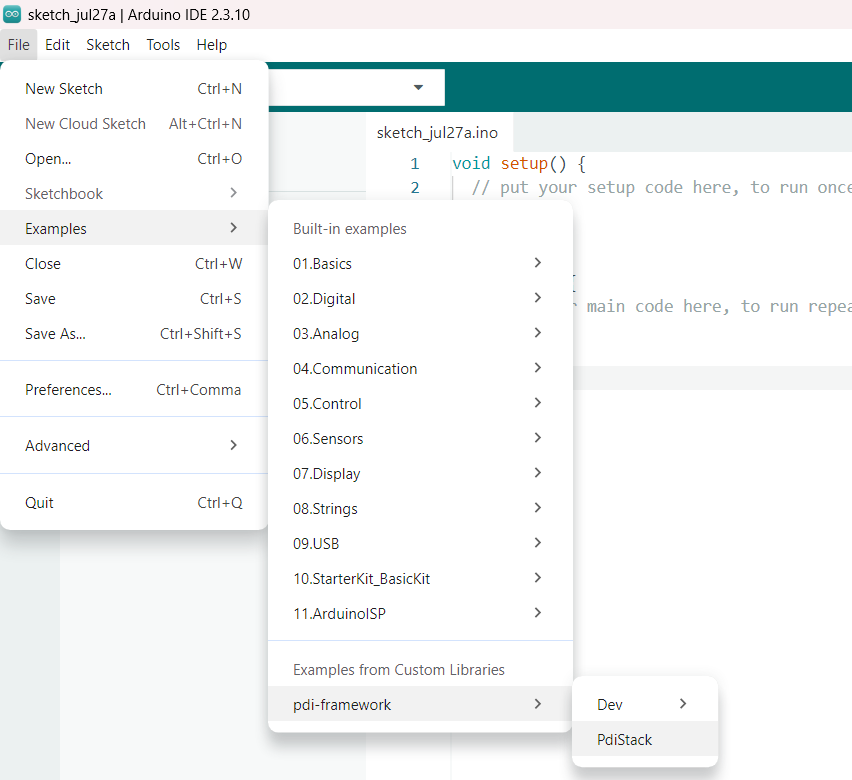
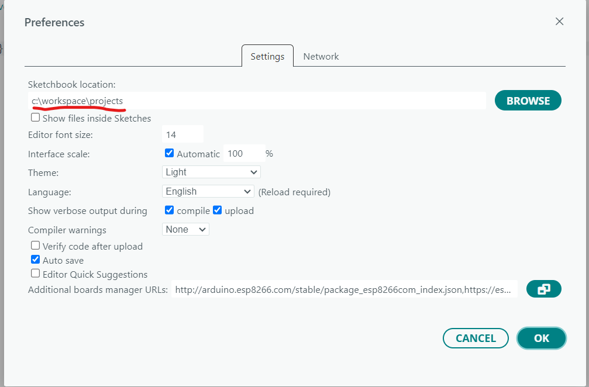
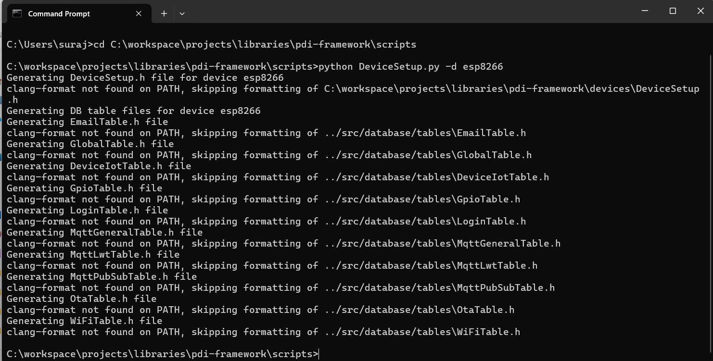
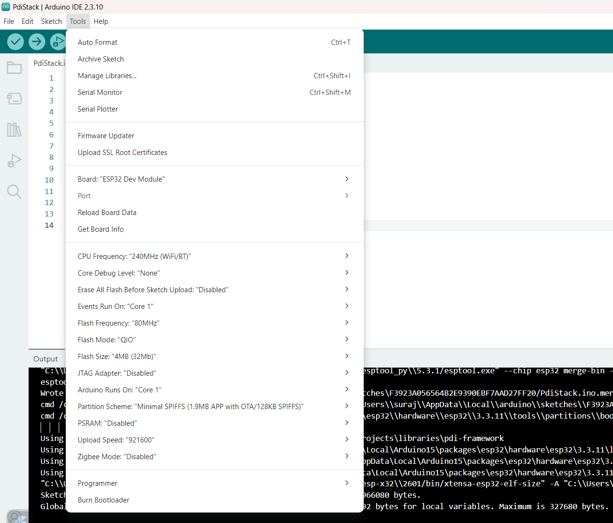

# 2. Build & Toolchain

The build target is the Arduino IDE / arduino-cli toolchain. Shared code holds at the `gnu++11` floor, because that is the oldest standard any supported core compiles with; other ports build at `gnu++17` and `gnu++2a`. `scripts/SyntaxSweep.py` compiles every file against all three, so a newer construct cannot quietly slip into a shared header and strand the oldest port. Beyond that and GCC's variadic-macro extension nothing is assumed, so PlatformIO or a hand-rolled `make` works as long as you reproduce the usual Arduino-core defines.

## 2.1 Board packages

| Board | Arduino board package version |
|---|---|
| Arduino Mega 2560 | 1.8.6 |
| ESP8266 | 3.1.2 |
| ESP32 | 3.3.3 |

These are the versions the adapters in `devices/` are written against. Vendor headers move between core releases, so a newer board package can need adapter changes.

## 2.2 Installing

Two routes: the Library Manager, or a git clone if you intend to work on the framework itself.

**Library Manager — builds for ESP32 with no setup script.**

1. Install the board package at the version above through the Boards Manager.
2. Tools → Manage Libraries → search `pdi-framework` → install.
3. File → Examples → pdi-framework → PdiStack, pick an ESP32 board and **Tools → Partition Scheme → Minimal SPIFFS (1.9MB APP with OTA)**, compile, flash. The image is about 1.9 MB; the default scheme's 1.3 MB app slot reports "Sketch too big".

   <table>
     <tr>
       <td width="50%"></td>
       <td width="50%"></td>
     </tr>
   </table>

A fresh install already carries ESP32-shaped placeholder database headers, and `devices/DeviceConfig.h` falls back to `PDI_DEVICE esp32` when no generated setup header is present — hence the zero-step ESP32 build.

**For ESP8266 or Arduino Mega 2560,** generate the per-device files first:

```
cd ~/Arduino/libraries/pdi-framework/scripts      # Windows: %USERPROFILE%\Documents\Arduino\libraries\pdi-framework\scripts
python3 DeviceSetup.py -d esp8266        # or arduinomega
```

That writes `devices/DeviceSetup.h` with the right `PDI_DEVICE` and regenerates the database table headers for the target. Changing boards later is the same one-liner with a different name. In a git clone the regenerated headers under `src/database/tables/` show as changed in `git status`; run the script with `-d esp32` before committing to put the checked-in ESP32 set back.

**Git clone, for contributors.**

1. Install the board package as above.
2. Clone into your Arduino `libraries/` directory:
   ```
   cd ~/Arduino/libraries
   git clone https://github.com/Suraj151/pdi-framework.git
   cd pdi-framework
   ```
   Linux and macOS use `~/Arduino/libraries/`. On Windows it is either `Documents\Arduino\libraries\` for a per-user install, or `%USERPROFILE%\AppData\Local\Arduino15\packages\<vendor>\hardware\<arch>\<ver>\libraries\` for a cross-arch one.
3. Run `python3 scripts/DeviceSetup.py -d <board>` if you are not targeting ESP32. Open a terminal at the sketchbook location, as in the images below.

   <table>
     <tr>
       <td width="50%"></td>
       <td width="50%"></td>
     </tr>
   </table>

4. Open the example, select the board, compile, flash.

   <table>
     <tr>
       <td width="50%"></td>
       <td width="50%"></td>
     </tr>
   </table>

There are no git submodules to initialise — LittleFS is vendored in-tree.

**PlatformIO.** `library.json` carries the build rules and the bundled-library dependencies, so a project needs nothing beyond the port selector:

```ini
[env:esp8266]
platform = espressif8266
board = nodemcuv2
framework = arduino
lib_deps = https://github.com/Suraj151/pdi-framework.git
build_flags = -DPDI_DEVICE=esp8266

[env:esp32]
platform = https://github.com/pioarduino/platform-espressif32/releases/download/stable/platform-espressif32.zip
board = esp32dev
framework = arduino
board_build.partitions = min_spiffs.csv
lib_deps = https://github.com/Suraj151/pdi-framework.git
build_flags = -DPDI_DEVICE=esp32
```

`-DPDI_DEVICE=<port>` selects the port on the command line and takes precedence over `devices/DeviceSetup.h`, so no script run is needed to change boards. The database table headers still come from `DeviceSetup.py` when you need a target other than the ESP32 defaults.

Two settings the ESP32 environment cannot do without. `board_build.partitions = min_spiffs.csv` gives each app slot 1.9 MB and keeps both OTA slots, where the `esp32dev` default of 1.31 MB cannot hold the image. And the platform line points at the `pioarduino` fork because the official `espressif32` platform pins Arduino-ESP32 2.x, while the framework builds against the 3.x line.

⚠ Do not set `lib_ldf_mode = deep+`. In that mode the dependency finder stops resolving `Networking` into the bundled `WiFi` library, and the ESP32 build fails on a missing `Network.h`. The default mode resolves it correctly.

## 2.3 What the scripts do

```
  DeviceSetup.py -d <board>
        │
        ├──▶ devices/DeviceSetup.h        #define PDI_DEVICE <board>
        │
        └──▶ CreateDBSourceFromJson.py
                   │  reads the board's DBTableSchema.json
                   └──▶ JsonToCpp.py ──▶ src/database/tables/*.h
```

| Script | Run it when |
|---|---|
| `DeviceSetup.py` | switching target device — it chains the database codegen for you |
| `CreateDBSourceFromJson.py` | changing the schema of the active device |
| `JsonToCpp.py` | never directly; it is the codegen engine |
| `Util.py` | never directly; shared template and path helpers |
| `GenTlsCerts.py` | provisioning HTTPS certificates off-device, or signing a device cert with a stable dev CA |

Generated headers are passed through `clang-format --style=Microsoft` when the formatter is on `PATH`, so they read like hand-written code. Without it they are written unformatted and compile the same.

## 2.4 Vendored externals

[external/littlefs/](../external/littlefs/) is the filesystem used by the storage interface on devices that have storage, and by everything downstream of it — SFTP, shell history, the file commands. Builds for a device without storage never reach it.

[external/fatfs/](../external/fatfs/) is ChaN's FatFs, used to mount the FAT volume on an SD card or one of its partitions. It is built only with `ENABLE_FAT_FS`, and only where the board's core does not already link FatFs; where it does (`DEVICE_PROVIDES_FATFS`), the core's copy is used through the same wrapper. Its code page 437 name tables — upper casing and the 437 to Unicode mapping, about 940 bytes — come from [external/FatFsUnicode.c](../external/FatFsUnicode.c), the same tables and lookups kept in flash rather than RAM.

### 2.4.1 NAT and mesh

Both are radio-level capabilities layered onto WiFi rather than regular services.

**NAT**, where the device supports it, rewrites IP-header fields on packets in transit so that clients joining the device's access point reach the upstream network the station link is connected to. It needs the IPv4 network stack the board's core supplies, in the variant that includes translation — on cores that offer the choice it is a Tools-menu setting. On the service side, `ENABLE_NAPT` makes the WiFi service schedule a one-shot NAPT enable once the station link is up.

**Mesh**, where the radio offers a connectionless peer-to-peer link layer, wraps that into a small API so applications can build broadcasts and hop-distance topologies without touching the driver. It shares the radio with station mode and is configured from the application. Paired with `ENABLE_DYNAMIC_SUBNETTING` and `ENABLE_INTERNET_BASED_CONNECTIONS` on the WiFi service, it gives each node a notion of how many hops it sits from the hub.

### 2.4.2 mDNS and DNS-SD

The responder is written from scratch on the network stack's raw UDP API — the datagram calls plus a multicast group join, taken under the stack's core lock where the port needs one — and runs as an ordinary service. No vendor mDNS library is involved.

```
  EVENT_WIFI_STA_GOT_IP
        │
        ├─ hostname pdi-<last-3-mac-bytes> written to /etc/hostname
        ├─ join 224.0.0.251:5353
        ├─ queue HTTPS cert provisioning        (where the port can generate certs)
        └─ answer queries as they arrive        (callback-driven, nothing to pump)
                │
                ├─ A                    →  hostname → address
                ├─ PTR _services…       →  which service types exist
                ├─ PTR <type>           →  instances of a type
                └─ SRV / TXT            →  port + metadata, bundled with A
```

It advertises what the build is actually listening on: `_http._tcp` or `_https._tcp`, `_ssh._tcp`, `_sftp-ssh._tcp`, `_telnet._tcp`. Outbound clients such as MQTT and OTA listen for nothing, so nothing is advertised for them. `cat /etc/hostname` shows the name, `ping pdi-<xxxxxx>.local` proves it resolves, and `service status MDNS` lists the address and the advertised set. Service types, TTLs and the multicast group live in [src/config/MdnsConfig.h](../src/config/MdnsConfig.h).

With runtime certificate generation on, the responder is also what provisions the HTTPS certificate. It is the one place holding both the address and the name, so the certificate it asks for carries `<hostname>.local` as a DNS subject alt name alongside the IP, and `https://pdi-<xxxxxx>.local/` matches it. Key generation wants several kB of stack and runs for seconds, so the responder queues it on the scheduler instead of doing the work in the event callback.

## 2.5 How the default port works

Three things line up so that a first build needs no scripts:

```
  devices/DeviceConfig.h
        │
        ├─ #if __has_include("DeviceSetup.h")  →  use the generated macro
        └─ #else                               →  fall back to the default port
                │
                ├─ per-port config cascade ends in that port's device_config.h
                └─ checked-in placeholder table headers match it
```

The default is whichever port `DeviceConfig.h` names in that `#else`, and it ships as `esp32` — the one place in the documentation where a particular board matters, because it decides whether you need to run anything at all before your first build.

Running `DeviceSetup.py` for another board overrides all three: the generated `DeviceSetup.h` wins over the fallback, and fresh table headers replace the placeholders. To come back, either re-run the script for the default port or delete `devices/DeviceSetup.h` and let the fallback take over again.

`DeviceSetup.h` is not tracked, so a fresh clone always starts on the fallback. A build that only needs a different port, and not a different table set, can say so on the compiler command line instead — `-DPDI_DEVICE=<board>` takes precedence over both the generated header and the fallback, and leaves the working tree untouched. See [§14.4](porting.md#144-how-a-board-gets-selected).

Because the fallback is silent, a build flashed onto any other board without running the script compiles happily with the default port's table set and feature flags — which is the one failure here that looks like a hardware fault rather than a build mistake. Run the script whenever you leave the default port, and again whenever you come back — `git checkout src/database/tables/` restores the placeholders if the generated ones are still lying around.

### 2.5.1 Per-port capability flags

Board-specific answers live in each port's `device_config.h`, not in the central config, which keeps the selection logic board-agnostic:

| Macro | Set by | Effect |
|---|---|---|
| `DEVICE_SUPPORTS_TLS` | a port with an SSL backend | lets `ENABLE_TLS_SERVICE` take effect; ports without it get the flag undefined automatically |
| `DEVICE_SUPPORTS_CONTEXTUAL_EXECUTION` | a port with the threading interfaces | same shape, for the cooperative and preemptive lanes |
| `DEVICE_SUPPORTS_TLS_CERT_GENERATION` | a port with the RAM and the RNG for it | gates on-device certificate generation |
| `DEVICE_SUPPORTS_NTP` | a port that can reach the network | the port can reach a time server, so the clock can call itself valid; a port without it still keeps time, counted from boot |
| `DEVICE_SUPPORTS_DRIVER_CORE` | a port with the flash and RAM for it | lets `ENABLE_DRIVER_CORE` take effect — devices found on the serial interfaces, their drivers, `/sys/bus` and `udevadm`; ports without it build none of it |
| `DEVICE_SUPPORTS_I2S` | a port with an I2S peripheral it can drive | lets `ENABLE_I2S_BUS` take effect |
| `DEVICE_SUPPORTS_I2C` | a port with an I2C bus it can drive | lets `ENABLE_I2C_BUS` take effect |
| `DEVICE_SUPPORTS_SPI` | a port with an SPI peripheral it can drive | lets `ENABLE_SPI_BUS` take effect |
| `DEVICE_PROVIDES_FATFS` | a port whose core already links FatFs | `ENABLE_FAT_FS` uses the core's FatFs instead of building the copy in `external/fatfs` |
| `MAX_DIGITAL_GPIO_PINS`, `MAX_ANALOG_GPIO_PINS`, `MAX_DB_TABLES` | every port | per-board limits |
| `ENABLE_NETWORK_SERVICE`, `ENABLE_AUTH_SERVICE`, `ENABLE_STORAGE_SERVICE`, `ENABLE_GPIO_BASIC_ONLY` | every port | per-board defaults — a port with no radio and no filesystem omits network, auth and storage; one with both enables them |

The contract is simple: genuinely per-board facts go in the per-port header, and the central `DeviceConfig.h` carries the cross-board feature flags, the auto-undef chains, and settings that are a property of the deployment rather than the board — the timezone (`TZ`, `TZ_SEC`, `DST_MN`) and `NTP_SERVER1` among them, so anything wanting local time does not have to reach into the NTP interface for it. A new port sets its `DEVICE_SUPPORTS_*` macros and the optional services fall in line by themselves.
